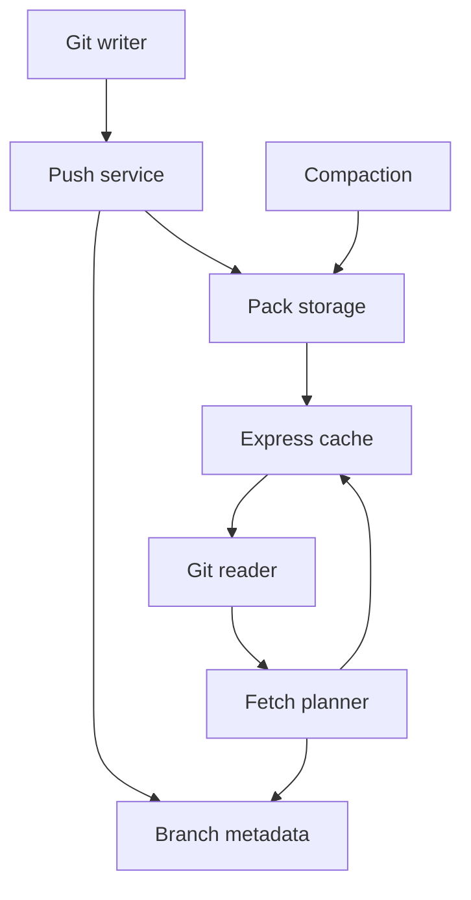

# Pando and the Local AI v1.2 Decision
## Public-source investigation and proportionate action plan

Prepared: 4 November 2026, Asia/Singapore
Status: Public-source analysis. No Pando deployment or local infrastructure change performed.

## What was verified

The supplied New Stack URL returned HTTP 403 to direct retrieval. Its indexed result identifies Frederic Lardinois' 2 November 2026 article and its headline figures. The primary engineering write-up was read directly:

https://openai.com/index/scaling-git-at-openai/

### Primary-source factual summary

OpenAI's 2 November 2026 engineering report describes a Git-compatible backend that stores immutable packs separately from versioned branch metadata. Branch updates are coordinated individually; readers do not receive a repository-wide point-in-time snapshot. Incoming packs are reused for reads, with regional Express caches and background compaction. The company reports nearly 80% lower median push latency, close to one petabyte delivered daily, and over 57 terabytes in an hour with over 99% of those bytes cached. These are company-reported production figures, not our measurements. The implementation uses Rust, Git conformance checks, deterministic simulation and formal methods. Rollout began through a proxy. The report discusses possible future sharing; it does not establish an installable public Pando backend.

### Conceptual data flow

OpenAI also reports a ten-week build from kickoff to production: one engineer designed the core, agents implemented it, and a small engineering group deployed it. This is an account of that project, not a general delivery forecast.

The following is a simplified reading diagram, not an implementation specification.

## How to understand the result

The explanatory mechanism is reuse and narrower coordination. Work that must be repeated for every reader is more expensive than serving an already prepared object. Independent changes can progress when they do not all wait on one shared decision point.

Those are architectural principles, not a claim that consistency or validation can be removed. A client still needs the dependencies that make a fetched revision usable. A faster backend is not equivalent to faster end-to-end development, and infrastructure throughput is not a measure of code quality.

The data-volume headline describes aggregate delivery. It is not a claim that a laptop, a few cores acting alone, or a free local deployment provides the whole storage/network system.

## Public artefacts and availability

The public openai/git repository is explicitly a fork of git/git:
https://github.com/openai/git

The public patch tracker distinguishes changes in the OpenAI build, proposals and upstream status:
https://oai-git.openai.chatgpt.site/

These are useful research artefacts. A modified Git client is not the Pando backend. The available evidence does not justify an instruction to download Pando, connect to an internal OpenAI service, or assume a public support/pricing contract.

This investigation uses public sources. No internal access or unpublished implementation knowledge is claimed.

## Implications for Will: adopt patterns at the actual scale

### The Anthropic comparison

Anthropic's primary report describes migrating its monorepo to Scion, an in-house system with an online-first client/server design, rather than retaining Git compatibility. It explicitly says Scion is unsuitable as a general Git replacement and targets unusually large workloads. That supports the article's architectural contrast; it does not establish that one approach is universally superior.

For this local pilot, an always-reachable central service would add a dependency. Retain the existing offline-capable tools unless actual requirements justify a different arrangement.

The following are our proposed local design choices, not claims that Pando has been reproduced.

Keep the candidate bottlenecks distinct:

| Case | Bottleneck to investigate | Local evidence needed |
| --- | --- | --- |
| Revolut-style inference economics | Cost constraints and task selection | Current usage, review burden and accepted output |
| Large source-control service | Coordination, repeated transfer and repository operations | Actual Git timings and workload before any optimisation |
| Will's first local workflow | Hardware fit, context, input preparation or correction effort, still unknown | One measured task on the intended computer |

A faster Git backend cannot by itself make the local model reason faster. A lower token bill cannot by itself make an output correct.

| Design choice | Small local implementation | Evidence before relying on it |
| --- | --- | --- |
| Preserve a familiar interface | Keep normal Git, LM Studio and the current project workflow | Existing commands/client path still work |
| Separate stable artefacts from changing state | Version inputs, outputs and configuration; keep a small status record | A run can be reconstructed from retained references |
| Isolate edits where useful | One branch/worktree or staged copy for the task | Uncommitted user work remains untouched |
| Reject stale updates | Check the expected project/file revision before applying a prepared change | A changed-base case is detected without overwriting it |
| Reuse justified computation | Reuse stable extraction or checks only for identical eligible inputs/settings | Deliberate source/config change invalidates reuse |
| Keep the acceptance path small | Required factual and permission checks remain before acceptance; optional optimisation follows | No required check has moved after release |
| Evolve through measured deltas | Compare candidate revision against the known working revision | Regression, recovery and field burden are checked |
| Keep capacity proportional | One active model request initially; larger concurrency only after a real need | Queue, cancellation and memory evidence |

Git's own worktree documentation supports more than one checked-out working tree. Use it for editing isolation where needed; it shares repository state and is not a security sandbox. Git update-ref documents updates conditional on an expected previous object ID. That is a useful existing primitive when a particular ref update is required; ordinary reviewed Git operations remain preferable to unnecessary plumbing.

Do not install a custom Git distribution or build a server to obtain these properties.

## What stays outside this increment

- Distributed metadata stores, regional cache fleets and custom packfile negotiation.
- A Pando replica or custom source-control platform.
- Automatic pushes, publishing, destructive history changes or uncontrolled concurrent agents.
- New background schedules or garbage-collection policy changes.
- Caching private/client payloads or treating a cached recommendation as current evidence.

Git maintenance has operations that alter configuration and start scheduled work. They are not a harmless default for a small pilot. Inspect the actual repository before proposing any maintenance change.

## Action plan tied to the existing /journey

| Milestone | Action now | Stop or defer when |
| --- | --- | --- |
| M0 | Inspect whether the actual task project uses Git; record revision and dirty state | No repository exists: use an ordinary staged copy, not a new server |
| M1 | Bind the fictional enquiry run to exact source/prompt/model/configuration references | Target device cannot be reached: finish independent work and hand over the missing check |
| M2 | Exercise stale-base, interruption and replay cases in the affected local project path | Recovery or source identity is uncertain: do not promote the result |
| M3 | Consider a second editing worktree or provider only for a concrete need | Added coordination outweighs useful work |
| M4 | Review recurring upkeep and actual benefit | Maintenance or review consumes the released capacity |

These actions strengthen traceability, reproducibility, controllability, stability and evolvability without assuming a distributed-infrastructure bottleneck.

## References

Friel, A., Blau, T., & Nyman, T. (2026, November 2). Scaling Git at OpenAI. OpenAI. https://openai.com/index/scaling-git-at-openai/

Anthropic. (2026, October 13; updated October 15). Redesigning source control at Anthropic. https://www.anthropic.com/research/redesigning-source-control

Git Project. (n.d.). git-worktree. Retrieved November 4, 2026, from https://git-scm.com/docs/git-worktree

Git Project. (n.d.). git-update-ref. Retrieved November 4, 2026, from https://git-scm.com/docs/git-update-ref

Git Project. (n.d.). git-maintenance. Retrieved November 4, 2026, from https://git-scm.com/docs/git-maintenance

Lardinois, F. (2026, November 2). OpenAI built itself a new Git backend, too. The New Stack. https://thenewstack.io/openai-pando-git-backend/ [Indexed result checked; direct article retrieval unavailable.]

OpenAI. (n.d.). Git [Source code fork]. GitHub. Retrieved November 4, 2026, from https://github.com/openai/git

OpenAI. (2026, October 31). OpenAI Git: Patches and notes. https://oai-git.openai.chatgpt.site/

